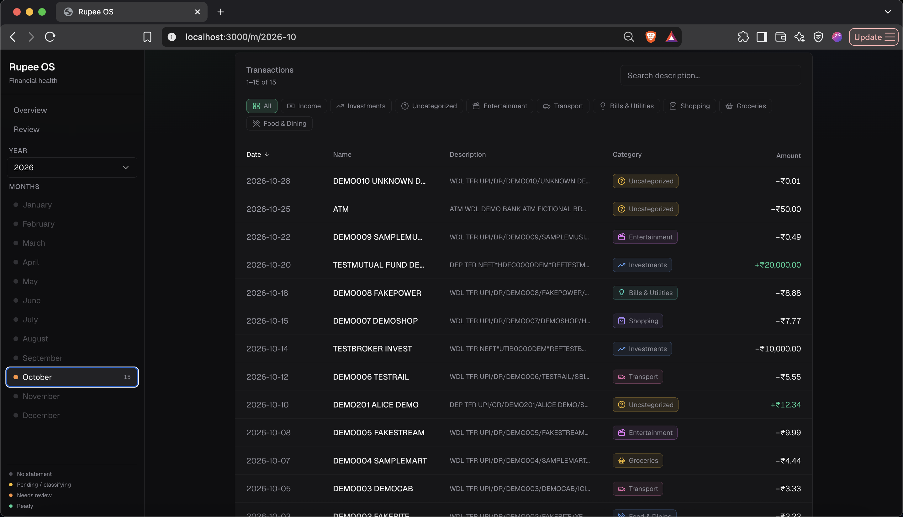
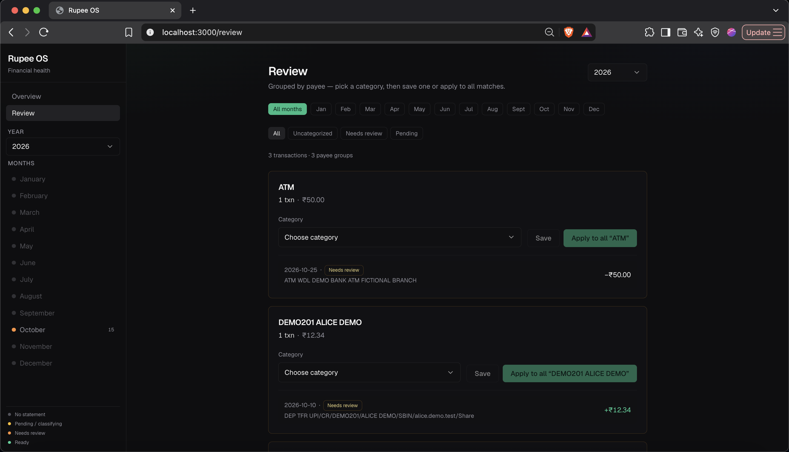
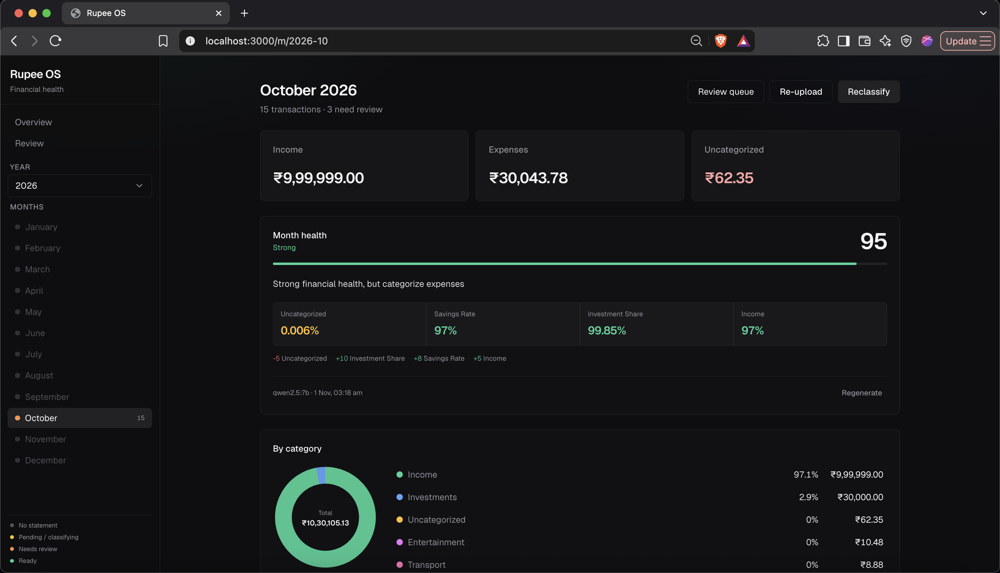

# Rupee OS

**Open-source, single-user, India-first AI financial health tracker.**

Upload a bank statement (**XLSX or CSV**) → validate **one calendar month** → classify **locally** with Ollama → review & correct → month health.

Statements never leave your machine. No cloud LLM.

[](LICENSE)
[](docs/ROADMAP.md)

---

## Features (v0.1)

- **Statement import** — Indian-style CSV/XLSX; one calendar month per file; duplicate detection
- **Local classification** — Ollama (Qwen) + merchant keywords + learned rules
- **Month dashboard** — income / expense / uncategorized, category pie, searchable txn table
- **Category chips** — icons + soft tints aligned with the pie
- **Review queue** — group by payee; fix one or apply to matching narrations
- **Month health** — deterministic score, insight metrics, reliability gate when uncategorized is high
- **Year overview** — months with status, optional year health

## Screenshots

Add images under [`docs/screenshots/`](docs/screenshots/) (see that folder’s README), then uncomment:

<!--
| Month | Review | Health |
|:-----:|:------:|:------:|
|  |  |  |
-->

*Screenshots coming soon — drop PNGs into `docs/screenshots/`.*

## Architecture

```
┌─────────────┐     ┌─────────────┐     ┌──────────────┐
│  Next.js UI │────▶│  Go API     │────▶│  PostgreSQL  │
│  :3000      │     │  Gin :8080  │     └──────────────┘
└─────────────┘     └──────┬──────┘
                           │ enqueue
                    ┌──────▼──────┐     ┌──────────────┐
                    │ Asynq worker│────▶│ Ollama       │
                    │             │     │ (local Qwen) │
                    └──────┬──────┘     └──────────────┘
                           │
                    ┌──────▼──────┐
                    │ Redis       │
                    └─────────────┘
```

| Layer | Tech |
|-------|------|
| Frontend | Next.js + TypeScript |
| API | Go + Gin + GORM |
| Worker | Go + Asynq (same image as API) |
| DB | PostgreSQL |
| Queue | Redis |
| AI | Ollama + Qwen2.5 (**local only**) |
| Deploy | Docker Compose |

```
frontend/                 Next.js app
backend/cmd/api/          HTTP server
backend/cmd/worker/       Asynq worker
backend/internal/         handlers, services, parser, classification
backend/migrations/
backend/testdata/         synthetic sample statements
docs/                     challenges, roadmap, screenshots
docker-compose.yml
```

## Quick start

**Requirements:** Docker + Docker Compose. ~8GB RAM recommended if you run the 7B health model.

```bash
git clone https://github.com/Omjaiswal26/rupee-os.git
cd rupee-os
cp .env.example .env
docker compose up --build
```

In another terminal (once):

```bash
./scripts/pull-ollama-model.sh
```

| Service | URL |
|---------|-----|
| Frontend | http://localhost:3000 |
| API health | http://localhost:8080/health |
| Ollama | http://localhost:11434 |

### Try the sample statement

1. Open a month in the UI (or create via upload).
2. Upload [`backend/testdata/sample_single_month.csv`](backend/testdata/sample_single_month.csv).
3. Wait for the worker to classify; use **Review** for anything flagged.

Or via API:

```bash
curl -F file=@backend/testdata/sample_single_month.csv http://localhost:8080/imports
```

`sample_multi_month.csv` should be **rejected** (multi-month validation).

## Statement rules

- Formats: **`.xlsx` / `.csv`** (Date + Narration + Debit/Credit-style columns).
- Each upload = **exactly one calendar month**.
- Multi-month, empty, or undated files are rejected with a clear error.
- Duplicate files (SHA-256) and duplicate transactions are skipped.
- **Never** commit or upload real bank statements to GitHub.

## Configuration

See [`.env.example`](.env.example). Important knobs:

| Variable | Role |
|----------|------|
| `OLLAMA_MODEL` | Classifier (default `qwen2.5:3b`) |
| `OLLAMA_HEALTH_MODEL` | Month/year health headline (e.g. `qwen2.5:7b`) |
| `CLASSIFY_CONCURRENCY` | Parallel classify jobs |
| `NEXT_PUBLIC_API_URL` | Browser → API |

## API (v0.1)

| Method | Path | Purpose |
|--------|------|---------|
| `GET` | `/health` | liveness |
| `POST` | `/imports` | multipart `file` upload |
| `GET` | `/imports` | list imports |
| `GET` | `/imports/:id` | import status |
| `GET` | `/months` | available months |
| `GET` | `/months/:yyyy-mm/summary` | totals + categories |
| `GET` | `/months/:yyyy-mm/transactions` | list / filter |
| `GET` | `/months/:yyyy-mm/health` | stored health report |
| `POST` | `/months/:yyyy-mm/health` | generate health |
| `GET` | `/transactions/review` | attention queue |
| `PATCH` | `/transactions/:id/classification` | correct + optional rule |
| `GET` | `/meta/categories` | allowed categories |

## Local backend tests

```bash
cd backend
go test ./...
```

## Troubleshooting

- **API unhealthy:** `docker compose logs api` — wait for Postgres/Redis.
- **Import stuck queued:** `docker compose logs worker`.
- **Classification pending forever:** pull the model (`./scripts/pull-ollama-model.sh`).
- **MULTI_MONTH error:** export a single calendar month from your bank.
- **Reset everything:** `docker compose down -v` then `up --build` and re-pull the model.

## Contributing

See [CONTRIBUTING.md](CONTRIBUTING.md) and [CODE_OF_CONDUCT.md](CODE_OF_CONDUCT.md).

## Roadmap

See [docs/ROADMAP.md](docs/ROADMAP.md). Building in public — Issues welcome.

## License

[MIT](LICENSE) © 2026 Om Jaiswal

## Privacy

Rupee OS is designed so **statement text is classified on your machine via Ollama**. Do not point `OLLAMA_BASE_URL` at a third-party host that logs prompts if you care about statement privacy.
